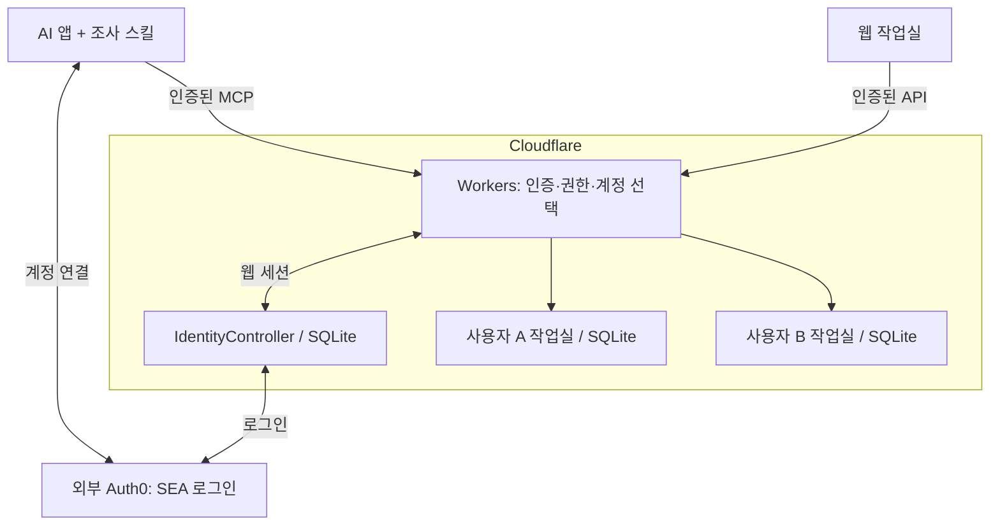

# SEA Research · 0.3.1

**한국과 베트남·인도네시아의 거래·장비 공급·설치·고용·파견을 조사하고, 근거와 미확인 사항을 개인 작업실에 보관하는 플러그인입니다.** SEA는 Southeast Asia(동남아시아)의 약자이고 등록 ID는 `sea-entry-check`입니다.

## 웹페이지 접속과 사용 가이드

웹은 브라우저에서 바로 접속합니다. **운영 웹을 쓰기 위해 서버를 설치하거나 npm start를 실행할 필요는 없습니다.** 사용 가이드는 로그인 없이 볼 수 있고, 개인 기록은 SEA 로그인 후 확인합니다.

| 무엇을 열까요? | 접속 주소 |
| --- | --- |
| 서비스 홈 — 소개·사용 가이드·내 작업실 | [https://sea-research-workbench.choisparta.workers.dev](https://sea-research-workbench.choisparta.workers.dev) |
| 내 웹 작업실 — 로그인·조사 기록·실행 현황 | [https://sea-research-workbench.choisparta.workers.dev/workspace](https://sea-research-workbench.choisparta.workers.dev/workspace) |
| 처음 사용자 가이드 — 설치부터 보고서까지 | [https://sea-research-workbench.choisparta.workers.dev/guide](https://sea-research-workbench.choisparta.workers.dev/guide) |

### 웹에 로그인하고 기록 찾기

1. 위 **내 웹 작업실** 링크를 누릅니다. 서비스 홈에서 **내 작업실 열기**를 눌러도 됩니다.
2. **로그인 · 새 탭**을 눌러 본인의 Google 계정 또는 SEA 이메일·비밀번호로 로그인합니다. 처음이면 로그인 화면의 **Sign up**에서 SEA 계정을 만듭니다.
3. 원래 작업실 탭으로 돌아옵니다. 접속 안내가 남아 있으면 **로그인 후 연결 확인**을 누르거나 새로고침합니다.
4. 왼쪽 **조사 기록**에서 저장한 제목을 선택합니다. **실행 현황**에서는 조사 진행과 도구 결과를 확인합니다.

**SEA 계정은 ChatGPT·Codex 계정과 별개입니다.** AI에서 연결한 SEA 계정과 웹의 계정·로그인 방식까지 같아야 같은 기록이 보입니다. Google 로그인과 이메일 가입을 섞지 마세요. 웹에서 직접 기록을 관리할 수 있으며, 채팅의 조사·자동 저장에는 연결된 플러그인/MCP가 필요합니다.

### 목적별 가이드 바로가기

- [플러그인 설치](https://sea-research-workbench.choisparta.workers.dev/guide#install) · [SEA 계정 연결·로그인](https://sea-research-workbench.choisparta.workers.dev/guide#login)
- [채팅에서 조사·초안 저장](https://sea-research-workbench.choisparta.workers.dev/guide#save) · [웹에서 기록 확인·검토](https://sea-research-workbench.choisparta.workers.dev/guide#view)
- [보고서 다운로드·PDF 저장](https://sea-research-workbench.choisparta.workers.dev/guide#report) · [시스템 설계도](https://sea-research-workbench.choisparta.workers.dev/guide#system)
- [로그인·저장 문제 해결](https://sea-research-workbench.choisparta.workers.dev/guide#troubleshooting) · [지원 문의](https://sea-research-workbench.choisparta.workers.dev/support)

기록이 없으면 **같은 SEA 계정인지 → 채팅에 저장 성공과 기록 링크가 있는지 → 웹 새로고침** 순서로 확인합니다. **검토 대기**는 저장된 초안을 사람이 검토할 상태입니다. 조사 보완은 채팅에 요청하고 최종 결론은 웹에서 직접 확정합니다.

보고서는 해당 기록을 먼저 저장한 뒤 **요약·결론 수치 대조 → 보고서 내려받기 · HTML → 내려받은 파일을 Chrome 등에서 열기 → 인쇄(Ctrl+P / ⌘P) → PDF로 저장** 순서로 만듭니다.

[0.3.1 시험 릴리스·패키지 다운로드](https://github.com/choisparta-code/sea-entry-check-public/releases/tag/preview-0.3.1)

## GitHub 사용자 마켓플레이스로 설치하기

OpenAI 공식 디렉터리 심사와 별개로, 아래 공개 GitHub 마켓플레이스를 추가해 **SEA Research 0.3.1**을 설치할 수 있습니다.

**마켓플레이스 저장소:** [https://github.com/choisparta-code/sea-entry-check-public](https://github.com/choisparta-code/sea-entry-check-public)

**마켓플레이스 이름:** sea-research · **표시 이름:** SEA Research

Codex CLI가 설치된 터미널에서 다음 명령을 실행합니다.

```powershell
codex plugin marketplace add choisparta-code/sea-entry-check-public --ref main
codex plugin add sea-entry-check@sea-research
```

1. 첫 번째 명령은 설치 목록에 **SEA Research** 마켓플레이스를 추가합니다.
2. 두 번째 명령은 그 목록에서 플러그인을 설치합니다. 데스크톱 앱의 Plugins 목록에서도 SEA Research 마켓플레이스를 선택해 설치할 수 있습니다. 목록이 갱신되지 않으면 앱을 재시작합니다.
3. 설치 후 본인의 SEA 계정을 연결하고 새 채팅을 엽니다. 웹에서도 같은 SEA 계정·로그인 방식을 사용합니다.
4. 처음 쓰는 경우 아래 웹 접속 안내와 [사용 가이드](https://sea-research-workbench.choisparta.workers.dev/guide)를 따릅니다.

카탈로그는 검증한 0.3.1 설치 원본의 **고정 Git 커밋**을 가리킵니다. main의 설명 문서가 바뀌어도 설치 원본이 자동 교체되지 않습니다. 새 버전을 배포할 때 원본 커밋과 카탈로그를 함께 갱신합니다. 사용자는 다음 명령으로 마켓플레이스 목록을 갱신할 수 있습니다.

```powershell
codex plugin marketplace upgrade sea-research
```

이 GitHub 등록은 OpenAI 공식 디렉터리 승인·검색 노출과 별개입니다. 공식 0.3.0 심사는 유지하고 승인 후 0.3.1 업데이트를 진행합니다. 마켓플레이스 추가만으로 플러그인이 자동 설치되거나 조사가 실행되지는 않습니다. 기존 시험 설치본을 사용하는 경우 새 설치와 중복 활성화하지 않도록 사용할 소스를 선택합니다.

## 버전·등록 상태

문서 갱신일: **2026-10-14 (Asia/Seoul)**. 마켓 상태의 마지막 확인일은 **2026-10-13**입니다.

| 구분 | 상태 |
| --- | --- |
| GitHub 사용자 마켓플레이스 | SEA Research 0.3.1. 공개 저장소 추가로 설치, 공식 디렉터리 게시와 별개 |
| OpenAI 공식 제출 | 마지막 조회: **0.3.0 · In review · Not published** |
| 출시 방침 | 현재 0.3.0 심사 유지 → 승인·공개 → 0.3.1 새 버전 제출·별도 심사·게시 |
| 운영 웹 | Cloudflare 웹·MCP/API 배포, Auth0 로그인·계정별 저장 |
| Claude 공식 제출 | 보류 |

기존 버전 승인이 새 패키지 심사를 면제하지 않습니다. 이번 README 갱신은 제출·승인·게시가 아니며 기존 시험 릴리스 ZIP·태그는 보존합니다. Git 문서의 최신 상태와 릴리스 당시 패키지 스냅샷을 구분합니다. 후속 제출 전에 패키지 검사·설치본 대조를 다시 수행합니다.

## 사용 순서

1. 위 GitHub 마켓플레이스를 추가하고 SEA Research 0.3.1을 설치합니다. 공식 디렉터리 공개 이후에는 공식 목록에서도 설치할 수 있습니다. ZIP을 채팅에 첨부하는 것만으로 설치되지는 않습니다.
2. 본인의 SEA 계정을 연결하고 연구 자료 읽기·초안 저장 권한을 확인합니다. ChatGPT·Codex 로그인과 SEA 로그인은 별개입니다.
3. 새 채팅에 **나라 → 요청 사항 → 간략 상황 → 저장 요청**을 전달합니다. 필요한 추가 질문에만 답하고 미정인 값은 그대로 둡니다.
4. 도구 실행 승인과 저장 성공·기록 링크를 확인합니다. JSON만 받은 경우는 서버 저장 완료가 아닙니다.
5. 웹에서도 같은 SEA 계정·같은 로그인 방식으로 접속해 수치·절차·출처·미확인 사항을 확인합니다.
6. 필요한 검토를 마친 뒤 웹에서 수정 이유와 최종 결론을 직접 저장합니다.

```text
가상 시험이야. 베트남 자회사에 Bluetooth 스마트홈 장비와
소프트웨어를 공급하고 한국·현지 직원이 설치할 예정이야.
세금·통관·제품 인증·출장 인력의 확인 사항을 정리하고 저장해줘.
미정 값은 미확인으로 남기고 최종 결론은 확정하지 말아줘.
```

**검토 대기**는 저장된 AI 초안을 사람이 검토할 상태입니다. 추가 조사 요청을 반드시 제출해야 한다는 뜻은 아닙니다. 보완 조사는 채팅에 요청하고 최종 결론은 웹에서 직접 확정합니다.

같은 이메일이어도 Google 로그인과 이메일 가입이 서로 다른 신원이라면 다른 작업실이 보일 수 있습니다. 기록이 안 보이면 AI 연결과 웹의 SEA 계정·로그인 방식부터 맞추세요.

## 제공하는 결과

- 공식 근거와 일반 규정, 개별 사례 적용 조건·미확인 사항을 구분합니다.
- 세율·기한 표, 조건이 갖춰진 단일 공제 지급 비교, 담당·행동·서류·시점·출처가 있는 절차 그림을 저장합니다. 실제 적용값이 미확인이면 null로 남기고 계산을 보류합니다.
- 질문별 법률 근거 장부와 변경 이력을 보관하고 사람의 수정 이유·실제 결과를 기록합니다.
- 요약 숫자와 저장 지표·조건부 계산값을 대조한 뒤 저장본 HTML 보고서를 내려받습니다. 브라우저에서 PDF로 출력할 수 있습니다.

입력 검사는 법률·세무 적용의 정확성을 보증하지 않습니다. 세금 신고·법률 대리, 자동 PDF 서버 생성·PPT 생성·자동 학습·예약 조사는 제공하지 않습니다. 원자료 스냅샷·원자료와 결과 버전 연결은 구현 범위에서 제외했습니다.

## 시스템 구조



SEA는 로그인 비밀번호를 연구 DB에 저장하지 않습니다. 인증 신원으로 본인의 작업실을 선택합니다. 실제 두 계정의 웹 목록·직접 링크·백업 조회 분리는 확인했으며 실제 계정의 모든 쓰기/MCP 공격까지 검증했다는 뜻은 아닙니다.

## 검증·남은 항목

개발 저장소의 2026-10-14 전체 테스트는 **89/89 통과**했습니다. 대표 시험 설치에서 조사·저장·재조회·웹 표/절차 표시를 확인했고, 추가 스마트홈 시험에서는 초안 저장·도구 재조회·미확인 유지·검토 대기 종료를 확인했습니다. 서버 출처 접속 검사의 호스트 제한 실패는 보존했습니다. 접속 성공도 사실 검증을 뜻하지 않습니다.

남은 항목은 공식 승인·게시와 일반 사용자의 공개 설치부터 실행·저장·웹 확인, 조사 HTML의 실제 PDF 인쇄 품질, 새 보고서 기능의 모바일 재검증입니다. 다른 AI 환경 전체, 실제 계정 쓰기/MCP 전환 분리, 사용자 증가 전 조회 비용 최적화도 후속 과제입니다.

## 스킬·연결·비용

| 스킬 | 역할 |
| --- | --- |
| entry-checklist | 상황별 질문과 계약·세금·인력·통관·규제 검토 |
| verified-research | 공식 근거·현행성·수치·적용 조건·충돌 확인 |
| research-record | 초안·근거·미확인·재검토 행동의 저장과 재조회 |

실행 흐름은 [live-workflow](references/live-workflow.md), 실무 기준은 [practical-output](references/practical-output.md), 웹 표시용 계약은 [result-view](references/result-view.md)를 따릅니다.

공개 HTTPS MCP 주소가 포함되어 있으며 설치 후 OAuth 로그인이 필요합니다. 별도 서버 설치는 필요하지 않습니다. 연결·저장 실패 시 실제 작업이 완료된 것으로 표시하지 않습니다.

서버는 별도 유료 모델 API를 자동 호출하지 않습니다. AI 앱의 대화 요금은 각 계정 조건에 따르고 Cloudflare·Auth0 한도/비용과 별개입니다. 시험 서비스는 공급자 한도·점검에 따라 제한될 수 있습니다.

[지원](https://sea-research-workbench.choisparta.workers.dev/support) · [개인정보](https://sea-research-workbench.choisparta.workers.dev/privacy) · [이용약관](https://sea-research-workbench.choisparta.workers.dev/terms)

공개 게시판에 비밀번호·토큰·개인정보·비공개 계약을 올리지 마세요.
